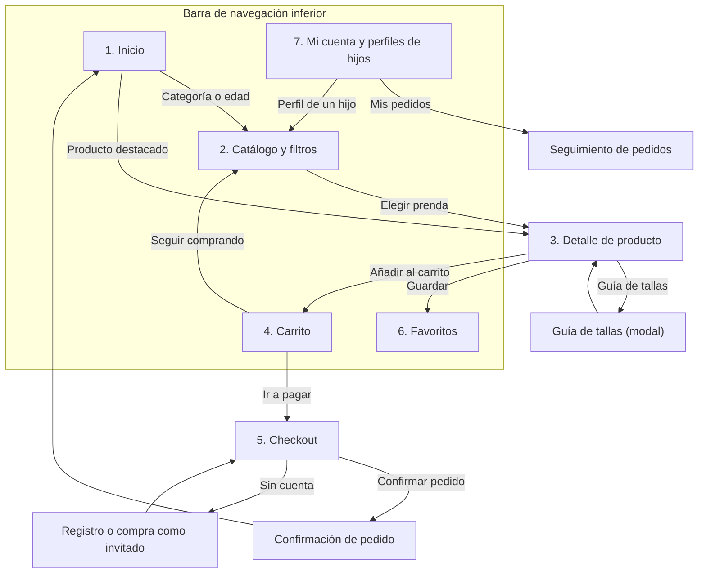

1.1 Justificación del Diseño:
- Importancia del Diseño Centrado en el Usuario: 

La importancia de este sale de el hecho de que un producto tiene buen valor si este es hergonómico. 

- Objetivos y Metas del Proyecto: Definición clara de lo que se espera lograr
con el diseño.

Se intenta hacer una interfaz clara y intuitiva para el usuario.

1.2

TRES OBJETIVOS MEDIBLES:

-Atraer a gran número de compradores en el menor tiempo posible

-Que el asistente al cliente pueda responder al momento de necesitarlo, sin esperas.

-Poder introducir los datos de envío y bancarios con eficiencia y seguridad.

1.3
 Beneficios Esperados: Ventajas que el diseño aportará tanto al usuario final
como al negocio o aplicación.

El negocio puede aprender y corregir lo que el público quiere, mientras que el usurio recive una buena interfaz de alta calidad, que reduce la pérdida de tiempo.

2. Investigación y Análisis de Usuarios:

2.1 Datos Demográficos y Segmentación

El público objetivo o Target audience, es de adultos que compran ropa para niños, como madres y padre jóvenes, abuelos o familiares cercanos, o compradores de regalos.

- Necesidades y Comportamientos: Identificación de lo que los usuarios
esperan y cómo interactúan con aplicaciones similares.

Los usuarios esperan encontrar la talla adecuada de ropa, poder usar filtros para encontrar rápido la ropa por talla, género, color...
O tener un gestor de ayuda al cliente fácil y  accesible. 

2.2

Ana Mena, 45 años, Su hijo de tres años se ha roto los pantalones y necesita unos nuevos, quiere comprar unos nuevos, necesita que lleguen pronto para un evento familiar que tiene.

Adolfo Gómez, 61 años, va a ser abuelo y va a regalarle ropa al niño para cuando este nazca, pero los padres no quieren que se sepa el género del bebé hasta el parto.

2.3

| App     | Qué hacen bien        | Qué hacen mal       |
|---------|-----------------------|---------------------|
| Mayoral | Escáner de códigos    | Bloqueos frecuentes |
| Zara    | Devolución con QR     | Falsa disponibilidad|
| Vinted  | Talla en edad y cm    | Estado según vendedor|

Conclusión: Priorizar talla por edad y altura, un carrito rápido y persistente, y accesibilidad desde el primer día.

- Insights y Hallazgos Clave: Puntos importantes descubiertos durante la fase
de investigación que influirán en el diseño.

-Como el usuario va a ser adulto normalmente, hacer la página a medida para esta edad, a pesar de que el producto esté destinado a otro tipo de audiencia.

-La talla de la ropa es algo por lo que se generan muchos errores y devoluciones, por lo que habría que incluir un gestor de tallas por altura, edad y peso.

-Este tipo de aplicaciones se suelen usar más en móbiles, por lo que habría que priorizar el diseño móbil.

-La Confianza al comprar un producto es indispensable, por lo que habría que ofrecer imágenes de calidad, vistas de detalle, medidas y, cuando sea posible, fotos en niños reales

3.it Diseño de interfaz

3.3

primary / onPrimary	

#00629E / #FFFFFF	6,48:1
#9ACBFF / #003355	7,70:1

primaryContainer / onPrimaryContainer	

#CFE5FF / #001D34	13,31:1	
#004A79 / #CFE5FF	7,23:1

secondary / onSecondary	

#526070 / #FFFFFF	6,43:1	
#BAC8DA / #243240	7,70:1

tertiary / onTertiary	

#695779 / #FFFFFF	6,48:1	
#D4BEE6 / #392A49	7,69:1

surface / onSurface	

#FCFCFF / #1A1C1E	16,69:1	
#1A1C1E / #E2E2E5	13,22:1

error / onError	

#BA1A1A / #FFFFFF	6,46:1	
#FFB4AB / #690005	7,72:1

#### Rejilla y medidas

Todas las pantallas usan frames Android Compact de 360×800 dp con la siguiente rejilla, aplicada en Figma como layout grid:

| Parámetro | Valor |
|---|---|
| Columnas | 4 (tipo Stretch) |
| Márgenes laterales | 16 dp |
| Separación entre columnas (gutter) | 16 dp |
| Ancho de cada columna | 70 dp |
| Unidad base | 8 dp |
| Área táctil mínima | 48×48 dp |

Reparto del ancho de 360 dp:

16 + 70 + 16 + 70 + 16 + 70 + 16 + 70 + 16 = 360 dp.

4.Validación y pruebas

4.1

-Que al usuario le llegen novedades de la ropa en el menor tiempo posible (aprox. 5 segundos después de abrir la app).

-Que la validación de los datos bancarios tarde como máximo 3 seg.

-La atención al cliente, al pasar con un ayudante humano, que este tarde menos de medio min en contestar al usuario 

4.2

|  | Tiempo objetivo |Sofia Gómez |Antonio ruiz|resultado|hallazgo|
|---|---|---|---|---|---|
|Novedades de ropa al abrir la app | < 5segs|4.2 segs|3.8 segs|Pasado|Rendimiento óptimo en carga de novedades: Ambos recibieron las novedades de ropa por debajo del límite de 5 segundos.
| Validación de datos bancarios | <3 segs|2.5 segs|3.2 segs|Pasado(Por muy poco)|Cuello de botella en la pasarela bancaria: Hubo un pequeño problema con la validación de datos en uno de los casos.
| Respuesta de agente humano en soporte|<30 segs|18 segs|24 segs|Pasado|La atención de soporte fue eficiente. Los tiempos de respuesta del equipo humano fueron de 18 segundos y 24 segundos.

PALABRA DEL DÍA: Despertador

4.3

ITERACIÓN:

Se ha añadido a la ventana de carrito una sección e3n la que el algoritmo recomienda una sección de prendas en base a lo que ha puesto el usuario en el carrito.

5.ENTREGA Y JUSTIFICACIÓN FINAL:

5.1

El diseño escogido viene de quien compra ropa infantil es un adulto con poco tiempo y que estas cosas normalmente se compran por móvil, cada decisión en la app intenta reducir el equivocarse de talla, que entiende lo que que esté pagando y su compra termine con el mínimo trabajo hecho.

5.2
RECOMENDACIONES:

-Validar con más usuarios y más perfiles. Las pruebas se hicieron con pocas personas. Es buena idea repetir las pruebas con más participantes, incluyendo abuelos y compradores de regalo, ya que abuelos y compradores de regalo necesitan más orientación, y con distintos niveles de experiencia con el móvil.

-Reforzar la ayuda con las tallas. La ayuda con las tallas es la principal fuente de dudas y devoluciones. Se recomienda un asistente de tallas por edad y altura. También se recomienda crear perfiles por hijo con aviso de cambio de talla.

-Medir en uso real, medir en uso real. Conversión, conversión. Abandono de carrito, abandono de carrito. Devoluciones por talla, devoluciones por talla.

6.REFERENCIAS BIBLIOGRÁFICAS

«Material Design 3 - Google’s Latest Open Source Design System». Material Design. https://m3.material.io/ (12 de octubre de 2026).
«Mayoral España | Tienda de Ropa Infantil y Moda Online». mayoral.com. https://www.mayoral.com/es/es/ (12 de octubre de 2026).
«Moda Infantil | ZARA España». https://www.zara.com/es/es/ninos-mkt1.html (12 de octubre de 2026).
«Vinted | La app para todas las cosas de segunda mano». https://www.vinted.es/ (12 de octubre de 2026).

